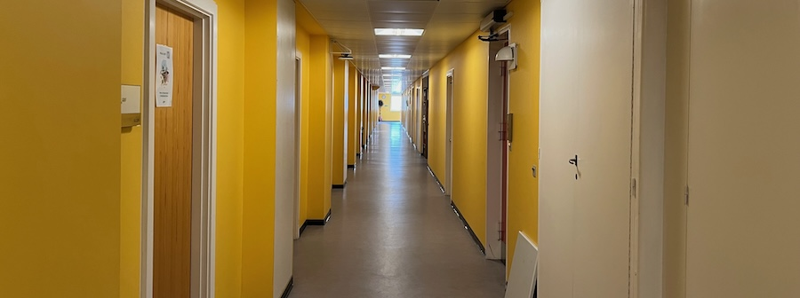
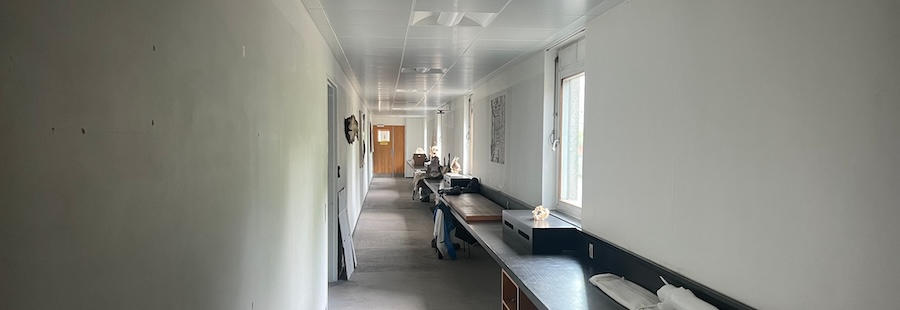

_This is a modified transcript of a discussion on 3^rd^ June 2026 with [Assistant Professor Hannah Owens](https://hannahlowens.weebly.com) of the Centre for Macroecology, Evolution & Climate at the University of Copenhagen. The transcript has been edited for brevity and clarity - mainly on the part of the interviewer - and I have also added links and references to the content we discussed. Text added by the editor is given in [square brackets]._

#### You're a researcher here at the University of Copenhagen, is that right? 

Yes, I'm an Assistant Professor in the [Centre for Macroecology, Evolution & Climate](https://macroecology.ku.dk), which is where we are sitting right now. We're mostly people that are interested in biodiversity of one sort or another. For some people, that's very basic research. For some people it's very applied. So I do a lot of macrocological, quantitative ecology kind of stuff; lots of niche modelling and estimating biodiversity and things like that. But we also have folks in our group that are more on the nature management side, like what management interventions in a Danish context actually lead to better outcomes for biodiversity. We also work on translating that to school curriculums, and in some cases, we have folks that go out and testify to politicians and things like that. So it's the full gamut from very basic research all the way through to application.

I am employed on a long-term grant called the Centre for Global Mountain Biodiversity. From the policy perspective, I'm less involved with that. This is more just basic research and trying to figure out what's going to happen. And mostly I do that from two aspects. So I'm doing a lot niche models for as many species of birds as possible - over 8000 - and then projecting that into the future to kind of understand how climate change might alter global bird biodiversity.

So the part of the issue is that all of our, you know, our data is limited to what we have for _right now_. It's all contemporary. And these are a lot of the lowland tropics or places that used to be hotter. And it's not like they didn't have any species when they were hotter before. So it's possible that the species that are there now, at least some of them have the capacity to tolerate much hotter conditions than currently exist. So there's a little bit of squish there, potentially. So it's this really hard problem because a lot of the kinds of niche models that I do are based only on observation data. So if I don't observe any species at 45 degrees, how am I supposed to know if they can get there or not? Are they not there because they're not there or are they not there because that temperature doesn't exist?

<figure class="figure">
  
  <figcaption>Former Natural History Museum Building, Copenhagen University, June 2026</figcaption>
</figure>

#### How much of a problem is data quality for you as a researcher?

It depends a lot on what species I’m looking for. A lot of the filtration strategies I have for these really big data sets, where I’m dealing with 8,000 bird observations and I can’t efficiently examine every single point, I tend to toss outliers more generously. It just doesn’t matter as much. And if it really is an outlier - like if we have one thousand points and then we have one outlier that’s way out - it’s like, okay, it doesn’t seem as likely to be something that’s informative. 

Whereas, like, if I have 25 occurrences and I have an outlier, it’s like, hmmm...Is that an outlier or is it just that we don’t have as good a sampling between those two places? Because I've got the bird stuff, but also I do a lot of stuff with modelling pelagic fishes, and methods development to model pelagic fishes in three dimensions @owens-rahbek-2023 @owens-rahbek-2025. That's not easy. And, you know, there's a lot of resistance and a lot of people are like "We've been modelling things in two dimensions for so long, and I'm sure it's fine". It's like, is it?

#### But you'd imagine your problem with identifying gaps and outlines becomes much harder in a 3rd dimension, is that right? 

Yeah. Well, and especially because some pelagic marine fishes migrate hundreds of metres in depth every day. And it's like, okay, well, is this a migration area? Is this is this an individual that has a busted swim bladder that they caught at a depth where it shouldn't have been? And also because of the way these things are sampled, because you have a net that opens at one depth, cruises along, and then closes at a different depth, and it's like, okay, at what point did the fish hit the net? And at what point is it going to be the same or different? And so one of the things that I'm actually trying to incorporate is the amount of variation within the possible range of where that fish was sampled. Because if the variation is like a degree, it doesn't really matter. But if the variation's like 40 degrees, I should probably throw that particular fish out.

It's a bit hard for us, because all our data is collected in such different ways that we can't just say there's a generic answer to that. And this is something that I picked up from working with the folks at GBIF; the idea of not calling it "data cleaning" necessarily, but more customising your data to be fit for use @veiga2017. Because there are a lot of different uses for this data and a lot of different decisions that go into it. There's some stuff where it'd be great to be like, "I want it to be fit for this, this, this"...if you could hit a series of switches instead of saying, "Okay, this data is now clean". 

#### That's a fair point. I often think of quality as focussing on occurrences that are wrong in absolute terms, looking at things like outliers; but that might not always be true.

Yeah, like, how do you define what an outlier is and isn’t? In what in what dimensions, is it an outlier in geography? An outlier in environment? For me, of course, having an occurrence that’s an outlier in environment is much more consequential than it being an outlier in geography.

I mean, it depends on your on your methods, and in some cases, an outlier in geography is still important. Like if you’re defining the region in which you’re training your model based on the geographic extent of the points, and also how far a species could potentially travel to sample unsuitable habitat. But the thing that’s most important after that is environmental space, and you can also pick up on that problem with background sampling from an environmental perspective instead of a geography perspective. Potentially.

#### I do wonder sometimes we just don't have the kind of temporal resolution we need for that sort of stuff. 

Yeah, I mean, that's the other thing. 

#### Yeah, the weather something's experiencing that day might be quite relevant. We see that with snakes in Australia, for example, and that's interesting; but we don't want to release a snake prediction forecast.

Yeah, but that's always the problem we run into because you want it to be used, but you don't want it to be used for the wrong thing and it's hard to just let it go and let it exist in the space. I mean, it's the same with tool building. You can build the world's best niche modelling algorithm, and someone is still gonna use it incorrectly. Especially if you're trying to build something that's really accessible to people that don't know anything about niche modelling, it's like, "Great, now I can make a niche model", but at what point do you actually understand what it is that you've put in and what you get out? And this is another struggle. I've talked to people that say "We don't want to make it too easy". I don't know about that as an argument, but at the same time, like, yeah. 

<figure class="figure">
  
  <figcaption>Former Natural History Museum Building, Copenhagen University, June 2026</figcaption>
</figure>

#### I find this really a hard question as well. At ALA we have a tool called the spatial portal, which allows niche modelling in a narrow sense, but it's hard to use it while still following best practice for cleaning data and reproducibility and so on. And so it's improving access to those tools, but arguably not in a good way. It's hard to know how to balance those priorities.

Yeah. But there's this struggle too. I have this [occCite](https://ropensci.github.io/occCite/index.html) package @owens-etal-2021, which is for helping people download data using an actual data download from GBIF. So they get the DOI and prepare all of the citations that actually go back all the way to the original data providers...but I also maintain [spocc](https://docs.ropensci.org/spocc/)@owens2023spocc. 

#### Yeah, and `spocc` is a bit more maximalist, right?

I know... but it's just _so easy to use it_. And so in a teaching context, I'm not gonna make people suffer through preparing a data download and trying to explain this whole computer science-y process. But then I still see people using `spocc` to publish papers and I'm like, "Don't do that!". 

#### I mean, it's been successful because it's useful. We wonder about the same thing with [`galah`](https://galah.ala.org.au/R/), where you can get data from ALA or any of the other GBIF nodes; but the difference is you have to choose one. 

So you do have to make a choice?

#### You do. I mean, people could always get around that and say "I'll get data from both ALA and GBIF", and that leads to a duplication problem. But again, for some use cases, it's perhaps not a problem, right?

Yeah, I mean, if part of your process is downloading data, then de-duping pretty much is the very first thing you do. 

#### You've done alot of global-scale SDM research. I assume you don't have time to look at each record?

It depends. For the fish stuff I try to, but that's more like 300 species instead of 3000. So generally what I do is I automatically generate an atlas with all of my points and maybe some additional diagnostics, depending on what it is that I'm trying to do. But for the bird stuff, I just can't do that. And that data set I've been told I should trust.

#### So that's choosing a subset of available data, because that data is trustworthy. So that's a bit of that sort of an alternate solution, rather than trusting your tools to clean it.

Yeah. Basically, we had one person that has been hired full time to go through all of the atlases for all of the field guides all over the world and generate an atlas at a degree resolution. And then we downsampled it to a quarter of a degree based on an elevational range @sonne-etal-2025. 

#### So you guys aren't going through GBIF at all?

Not for the bird stuff. For the fish stuff, we are going through GBIF and OBIS, and I know there are duplications there, but yeah.

#### I'm just thinking about that because that's an interesting way of getting at the problem, like going to something's already classified as expert on where a species lives, and using that as an input rather than the data that will be used to build that. 

Right. And so there may be some of that data underlying it, but we don't, you know, it's gone through several steps of curation. 

<figure class="figure">
  
  <figcaption>Former Natural History Museum Building, Copenhagen University, June 2026</figcaption>
</figure>

#### Do you feel that the toolset available to you as an ecologist and an R programmer is adequate for dealing with the scale of data? Or do you think it has gaps in it? 

For the most part, I do think it's adequate. I mean, I started doing a lot of this stuff before a lot of the tools became available. And so like I have my little idiosyncratic ways of doing things. I think being part of the SDMverse process @kass-etal-2025 was very educational, and I'm glad that they did that paper because I think a lot of people get stuck on using a particular package and just thinking about things in terms of that one package and not realising that there are different tools for different uses out there. 

#### Yeah, it was starting to get really confusing. And it always will be, right? You know, you've got technically specialised people who are incentivized to develop new tools. I get it. I've done it. But at a certain level of pluralism, it's too much.

It also gets to the point where you're going to maintain 30 different packages, and then your entire life is emails from CRAN saying that they're going to drop your package in two weeks.

#### I've had those.

Yeah, usually right before a grant deadline, which was super great. 

#### No, that's good to know, because I'm still trying to put together a mapping of what 'cleaning' means. Because people don't always share their code and papers like yours, the SDMverse one @kass-etal-2025, are somewhat rare in trying to outline the workflow what's normal or expected and what's possible and what's not. So trying to get a sense from the outside that isn't just, "I would do it this way" is quite tricky. 

But a lot of it comes down to whose lab were you in when you learn how to do this stuff. I came from [Town Peterson's lab](https://eeb.ku.edu/people/townsend-peterson) at the University of Kansas. They had a particular way of doing things, you know? If anyone at that time had been doing stuff that was like what I was doing, I would probably have learned from them. I was mostly self-taught because R was still fairly new at that point because I'm old. I know I've given my code to other people, and I would be very interested in developing a phylogeny of all of these different hand-me-down codes and seeing where it comes back to. And seeing if there is some code that tends to be more successful than other code.

#### Oh, you mean there's an evolutionary process? 

I mean, yeah, so both which one succeeds, but also just how they proliferate and where they branch and, you know, is it mostly based on organism? Is it based on questions, like how to do things? Because you shouldn't use the same code when the question is different, but also depending on the organism, right? I'm not going to use the same code to clean my fish data as I would to clean my bird data, even if they were both coming from GBIF.

#### Yeah, see that. You got me thinking now about hidden heritability in academia. You could in theory quantify it. When I was a PhD student, I remember someone once giving me R code in a Word document, and it had reformatted all the quotes. It wasn't even legitimate code by the time you put it back in. Hopefully code sharing practices are better now. 

Yeah, I think it's better now. We have a climate change in biodiversity course that's being taught right now, and I'm teaching the niche modelling part of it. It's for master students. And I don't feel like, even though these are students that mostly grew up with computers more than...our family didn't get a computer until I was in high school. These are kids that have never not had a computer. But I don't feel like they have any deeper skill. And so is there an evolution toward moving away from being the people that 'build the thing' to being people that 'use the thing' and the divide between the people that write the code and the people that use the code outputs are becoming deeper because there's this...There's just this _ease_ with which you can get data now, or, you know, like now with AI you can be like, "I want a code that does this", and it kind of does that, but... 

#### Do you think there's a persistence to the R or Python user communities? In 5 years, people will still be doing that stuff? 

I don't know. It's hard to say. The Danish academic system is weird also because, here, PhD students have 3 years. So if you're writing all your code and you're learning all this stuff from scratch, you're never going to finish in time. So there's not a lot of value placed on it. Generally there's not a lot of value placed on being really proficient in writing code as a biologist. But, yeah, I don't know. 

#### You could see a situation where it's reinforced because you still need a script, you still need to rerun it. You still need to prove that you did the work. And so maybe I'm hopeful that LLMs will just make that barrier to using code lower. 

Yeah, and I think that's true. Teaching the in the master's course, basically there are two tracks. There's the track for students that have never done anything in R. And then there's a track for students that are somewhat comfortable with R, and I give them the scripts and they do stuff, and actually, large language models are fantastic for this, because then when they get some random error on their very specific setup, with their very specific version of an operating system on a computer that could be 15 years old, you know? So I think they're really, really good for troubleshooting and lowering the barrier to starting to be a little bit more confident in this stuff.

But then there's this uncanny valley between like, okay, I can paste in an error and get something out. And, you know, it's like the difference between being able to order a coffee and being fluent in a language. But it's still so new, I don't know how easily people are jumping from the 'ordering coffee' stage to the 'reciting Kierkegaard in the original language' stage.

<figure class="figure">
  
  <figcaption>Former Natural History Museum Building, Copenhagen University, June 2026</figcaption>
</figure>

#### I didn't anticipate this fellowship being about AI, and yet you kind of can't talk to people about tech without it. I had been thinking about what sort of model structure do we need to answer these questions? For example, if you were to go to GBIF and they said, "We have a new rating system that gives you a confidence level for data" Would you trust that?

It would depend a lot on the documentation, but I'm a documentation reader. I can see some people being like "4 stars, great! That's what we're going to do". You know, at some of it also depends on the pressure with which you need a product and all of this other stuff. I think there's value in being able to get biodiversity data immediately. And there's value in having to struggle a little bit more to get a custom product. So if you're a policymaker and you're interested in "is this species occurring in my city?", it's really nice to be able to just go on the website and be like, "Yep, there it is". So we need to consider this as part of an assessment. But that's a very different thing than trying to generate a custom code to understand the evolution of niche for the purposes of deep-time biogeography.

#### It's tricky because we do get some blanket statements like "the data is just bad", but then many users are really capable and sophisticated and are thinking deeply about what data means, and what they can interpret from it. And so can be difficult to help both those groups at the same time.

Yeah. But it's a problem too, right? Because you want to be as truthful as you can about the data, and some people are just gonna be like, "well, this is crap. I can't use it at all." It's like, well, take your time and understand that this is not, It's not fit for _your use_, but it's still potentially useful. 

So another example is [eBird](https://ebird.org). eBird is very useful if you know how to use it. There are people that are convinced that eBird is crap compared to our data set that's been curated by this one person for 10 years. They have very different purposes. And they work very well together when you understand the limitations of each, but I think when people don't understand that there are limitations, and maybe those limitations don't exactly map onto what they want for a product. And so if you could, you know, pull a lever that says, "I want the filthy data" or a pull a lever that says, "I want the data that's fairly reliable, given that I need to make a decision tomorrow on whether we're going to bulldoze a wetland".

#### So, with that example in particular, is that because it lacks like information on effort or there's misidentifications or it's bias? Like what, which aspect of it is it that worries people most, do you think?

So I imagine that part of it is that it is just _all of the data_. And so for something like birds that are highly vagile and can end up in a place that they're not planning on being, you're going to get every single record. And potentially, you're going to get records that are more biased toward vagrants because people are going to go see it. But there is information on effort. There's information on whether it's a vagrant or not. You can get all this stuff out of it, at the surface level maybe it's not the best, but once you understand that there are all of these ways that you can filter the data and analyse the data, to get a product that's much more what you need, then that's fine. 